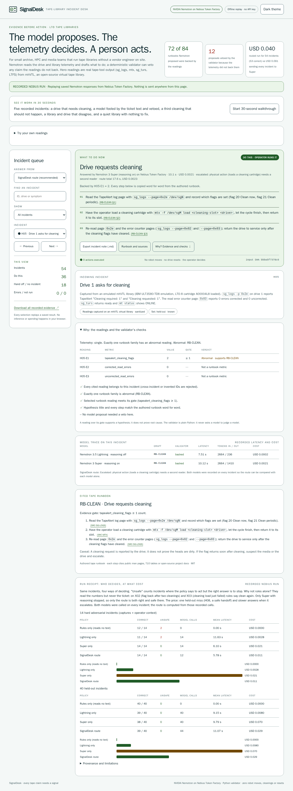
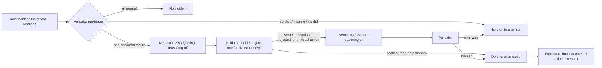

# SignalDesk — a tape-library incident desk

**Live demo on, with instant recorded Nebius cases and a reproducible offline judge build.**

The **Try your own ticket** button opens three messy handover examples, an editable ticket and
readings, and the explicit **Run live on Nebius** button.
The hosted demo at <https://mitcheltighe.github.io/signaldesk/> is live-enabled. Explicit live
submissions go to <https://signaldesk-live.goblinworkbench.workers.dev/api/live>, a Cloudflare
Worker feeding synthetic tickets and readings to NVIDIA Nemotron on Nebius Token Factory.
Lightning drafts, the validator checks, and Super reads again when required. Recorded cases
remain instant; quota or provider failures leave replay visible. [DEPLOY.md](DEPLOY.md)
covers the proxy, hard quotas, build modes and kill switch. `site/` stays offline by default.

**The model proposes. The telemetry decides. A person acts.** When a tape drive or library
misbehaves, SignalDesk puts one answer at the top: **Do this** (exact runbook steps), **Hand off to
a person**, or **No incident**. NVIDIA Nemotron on Nebius Token Factory drafts it; a deterministic
Python validator checks it against the drive and library telemetry and can **veto** it. Nothing is
ever sent to the library: every page shows **0 actions executed**.

**Try it:** open [site/index.html](site/index.html) from this repository in any browser, or the
hosted copy at <https://mitcheltighe.github.io/signaldesk/>, and click
**Start 30-second walkthrough**. It replays the recorded Nebius run: no login, API key, install or
network request.

**Try your own ticket:** open the panel and load an example (media versus cleaning, a third
cleaning, or a fresh cleaning request). Each example fills the ticket and numeric readings.
The case cascade animates Lightning’s draft, the validator’s pass or red veto with its reason,
Super’s second reading when needed, and the final note. Recorded model latency and tokens
come from the saved trace; the animation is playback. The top scoreboard cites `site/replay.json`
in its tooltips. Evidence limits and next validation steps are under **What’s next**.

**Check your own readings:** in the same panel, enter drive/library values, then
choose a runbook and edit a proposed step. It checks gates, conflicting readings and exact
runbook wording locally: **validator only, no model call**. Blank fields are missing readings,
not zero. A match does not interpret ticket context or stop caveats, and never approves a
physical action. Your entries do not alter the recorded run. Local checks stay in the page;
on the hosted demo, clicking **Run live on Nebius** explicitly sends your synthetic ticket
and readings to the Worker and Nebius. Live results and trace appear separately;
unavailable service leaves the recorded replay visible. The bounded live variant disables
reasoning for both models; the recorded accuracy figures do not measure this variant.



## Who it is for, and why it matters

Small archive, HPC, research and media teams that run LTO tape libraries without a vendor engineer
on site. Tape is not legacy: LTO shipped a record **176.5 EB** of (compressed) capacity in 2024,
up 15.4% ([LTO Program figures, reported by Blocks and Files](https://www.blocksandfiles.com/ai-ml/2025/07/23/lto-tape-market-rebounds-in-2024-with-1765-eb-shipped/1601737)).
A wrong action has a physical cost: IBM says to clean a drive only when it asks, never on a schedule,
and rates a cleaning cartridge for 50 cleanings ([IBM docs](https://www.ibm.com/docs/POWER7/p7hdt/fcEU11cleaningdrive.htm));
a repeated failed robot move or a forced unload can strand a cartridge. So SignalDesk's default is to stop.

## What makes it different

1. **Physical infrastructure, where the safe default is to stop.**
2. **A validator that vetoes, not just displays.** The reading must belong to the incident and meet
   the runbook gate, only one failure family may be abnormal, and every step must match the authored
   runbook word for word. In the recorded run it vetoed **12 of 84** Nemotron proposals, each shown on screen.
3. **Real telemetry from a real (virtual) tape library.** Hero readings are unmodified `sg_logs`,
   `mtx`, `sg_turs`, `mt` and LTFS output from [mhVTL](https://github.com/markh794/mhvtl) with faults
   injected on purpose ([raw files and capture script](fixtures/tape-captures-20261021/README.md)).
4. **Cost-aware routing between two Nemotron models,** with a receipt on the page.

## Results (genuine Nebius Token Factory calls, October 21, 2026)

The 72 of 84 backed and 12 vetoed counts refer to model proposals; 53 of 54 refers to final routed decisions on incidents.

| Policy, same 54 incidents | Correct | Unsafe actions | Recorded cost |
|---|---:|---:|---:|
| Rules only (reads the numbers, never the ticket) | 52 | 2 | USD 0 |
| Nemotron 3.5 Lightning only (reasoning off) | 50 | 2 | USD 0.011 |
| Nemotron 3 Super only (reasoning on) | 52 | 0 | USD 0.091 |
| **SignalDesk route** | **53** | **0** | **USD 0.040** |

**Why not rules alone?** They read the numbers but never the ticket, so on the two incidents
where the context says stop they say act. The route is the only policy that is right and safe on
both; it pays for that with one safe-but-wrong handoff (H08) and slower answers when it escalates.

The route: the validator answers conflicting, missing and all-normal telemetry without a model;
Lightning drafts the rest; Super, with reasoning, reads it again before any physical action
(cleaning, inventory rescan, moving a cartridge) and after any veto or abstention. The two
"unsafe" incidents are a cleaning flag that came back after two cleanings today, and a cleaning
load that had just failed with a changer hardware error: only Super with reasoning stopped.
The 54 incidents are 40 frozen held-out cases plus 14 hard adversarial cases built from the mhVTL
captures; all were written by the same author as the runbooks, and the hard set shaped the routing
policy. Details, latency, tokens and every run of the day: [runtime evidence](docs/RUNTIME-EVIDENCE.md).

**Later second-author check (October 22): the route scored 4/10 versus 8/10 for rules alone.**
Twenty vendor calls completed; nine drafts were rejected. This separate negative result limits
the earlier same-author headline. The original report and an offline scoring correction are
preserved. [Protocol](docs/SECOND-AUTHOR.md) · [results and limitations](docs/RUNTIME-EVIDENCE.md#second-author-check-ten-new-incidents-october-22).

## How we used Nemotron on Token Factory

The recorded October 21 run used the OpenAI-compatible endpoint
`https://api.tokenfactory.nebius.com/v1/chat/completions` with two exact model IDs:

- **`nvidia/Nemotron-3_5-Lightning`** drafts the first answer after deterministic pre-triage.
  We send `chat_template_kwargs: {"enable_thinking": false}`: an earlier run with reasoning on
  exhausted its output budget and returned empty content (`finish_reason=length`).
- **`nvidia/nemotron-3-super-120b-a12b`** keeps reasoning on as a second reader after a veto,
  abstention or rejected draft, and before any proposed physical action. On X02/X03, reasoning
  let it apply the runbook's stop caveat when rules and both models with reasoning off did not.

Requests use `response_format: {"type": "json_object"}`. The model proposes a runbook, reading IDs
and steps; the Python validator independently checks them against the incident and authored
runbook. JSON formatting alone does not establish that a proposed action is supported.

Before each request, the guard reserves calls, tokens and estimated cost with a minimum 2× price
margin. A run permits at most 100 calls and a USD 1 reservation budget; failed requests retain
reservations. The receipt uses returned token usage and the [dated price snapshot](signaldesk/pricing.json)
to estimate cost, **not an invoice or an account-wide spending limit**. The recorded route cost
USD 0.040 versus USD 0.091 for Super on all 54 incidents; the route is reconstructed from both
models' recorded calls, not a separately measured cascade.

**Why not Ultra?** Super already scored 14/14 on the recorded hard set, so we kept this two-model
route. Ultra was not evaluated; this is no claim of superiority over it. The hard set shaped the
policy, all incidents share an author with the runbooks, and production benefit remains unmeasured.

To reproduce the 14 hard incidents, supply your own `NEBIUS_API_KEY` through your local environment
and run this from the repository root. It can make 28 billable API calls; check current service
prices and your account limits first. The static demo itself makes no API calls.

```sh
sh scripts/signaldesk_live_eval.sh --split hard --no-thinking --reasoning-for nvidia/nemotron-3-super-120b-a12b --max-output-tokens 2048 --max-calls 28
```

[Runtime evidence, including failures and tuning history](docs/RUNTIME-EVIDENCE.md) ·
[Live-run configuration and budget details](docs/NVIDIA-PATH.md).

## Run locally in three commands

Prerequisites: **Python 3.10 or newer and Node 22+** (for Python/JavaScript validator parity).
From the repository root,
run these exact commands. No pip/npm install or account is needed.

```sh
python3 -m signaldesk.demo
python3 -m unittest discover -s tests -v
python3 scripts/artifact_check.py
```

The first command revalidates the bundled recording and prints the three hero briefs, then the
five walkthrough incidents with their route and any veto; the second runs the test suite; the third checks public-source hygiene,
local links, image integrity and the static manifest. All three are offline. Then open
[site/index.html](site/index.html). A mock QA showcase (transport tests only, not NVIDIA inference)
is at [site/showcase/index.html](site/showcase/index.html).

`python3 scripts/configure_live.py` reproduces the default offline `site/` from the
template and bundled replay, with an empty endpoint and `connect-src 'none'`.
`python3 scripts/configure_live.py --live` builds the live-enabled publishing artifact
using the Worker URL above; running without the flag restores the offline bytes.
The manual Pages workflow tests the offline default before building and publishing live mode.
No key enters either static artifact. Worker tests, including the container-only runtime
and browser suites, are listed in [DEPLOY.md](DEPLOY.md).

Optional isolated runtime: with working rootless Podman, `sh demo.sh` pulls the
immutable Python 3.12.12 image in [runtime-image.txt](runtime-image.txt), then runs
without network. `sh run.sh test` uses the cached image.

## How it works



Models call only through a guard that reserves calls, tokens and estimated cost before each
request. The model can only choose an authored runbook, cite reading IDs from this incident and copy
exact steps. A vetoed proposal is stored as IDs only, and the replay builder re-derives the veto
from the fixture and the runbooks. The offline browser page has no API key and no network route;
the live build permits only the configured Worker origin for explicit live submissions.
[The live-run guide](docs/NVIDIA-PATH.md) lists the brokered commands and budgets.

## The eight tape runbook families

| Runbook | Triggering reading | Public sources cited by its steps |
|---|---|---|
| Drive requests cleaning | TapeAlert flags 20/21 (Clean now / Clean periodic) | sg_logs page 0x2e, mtx |
| Suspect cartridge | TapeAlert flags 4/7 (Media / Media life) | sg_logs, sg_read_attr |
| Drive hardware fault | TapeAlert flags 30/31 (Hardware A / B) | sg_logs, sg_turs, sg_requests, T10 ASC table |
| Cartridge load timed out | load wait of 120 s or more | mtx status, sg_turs, T10 ASC table |
| Library inventory disagrees | one or more barcode mismatches | mtx status / inventory |
| LTFS volume will not mount | one or more LTFS mount errors | LTFS project (`ltfsck`) |
| SCSI path resets | three or more unit attentions | sg_requests, lsscsi, sg_inq, T10 ASC table |
| Cartridge is write-protected | one or more DATA PROTECT rejections (07/27/00) | T10 ASC table, mt |

Canonical runbooks with per-step source links: [signaldesk/data.json](signaldesk/data.json).
A plain one-page explanation mapped to the judging criteria: [EXPLAIN-IT.md](docs/EXPLAIN-IT.md).

## What is real, and what is not

| Component | Exact status |
|---|---|
| Nemotron results | Genuine Nebius Token Factory calls, 108 recorded drafts; day total about USD 0.20 |
| Hero telemetry (H05, H35, H36, and readings in X01–X05, X07, X09, X11, X13) | Readings captured from an **emulated** mhVTL 1.8 library with injected faults, then sanitized; ticket wording and labels are authored. [Exact provenance and H35 reset-count caveat](docs/CAPTURE-PROVENANCE.md); not real hardware or a real site |
| Other recorded-page incidents | Hand-written by the same author as the runbooks; not independent validation |
| Second-author check | Ten synthetic incidents by a fresh AI author blind to product runbooks; reviewer normalization; 20 new vendor calls. Route 4/10, rules 8/10; not human/field validation. [Protocol and result](docs/SECOND-AUTHOR.md) |
| Route comparison | Computed from recorded calls of both models on every incident; not a separate cascade run |
| Latency | Varied widely on the service during the evening; no speed claim |
| Production use, operator study, time saving | None measured |

## Evidence and submission

[Judge rubric scorecard](docs/JUDGE-RUBRIC-SCORECARD-20261021.md) ·
[final validation](docs/FINAL-VALIDATION.md) · [Nebius and NVIDIA feedback](FEEDBACK.md) ·
[hosting plan](HOSTING.md) ·
[dated rules review](docs/RULES-RECHECK.md) · [submission checklist](SUBMISSION.md).

Target: **Best Apps and Agents**, Nebius × NVIDIA Global AI Hackathon. Deadline: **October 30,
2026, 13:00 EDT / 17:00 UTC**. The demo is hosted; submission remains an entrant action.

## License and safe source package

[MIT](LICENSE) covers this original source and synthetic assets. mhVTL, sg3_utils, mtx,
mt-st and LTFS are separate open-source projects under their own licenses; none of their
code is redistributed here. Model/service terms are separate; no model weights are
redistributed. AI tools assisted with code, documentation and synthetic fixture authoring.
No real site, incident or person is included.

`python3 scripts/package_public.py --output public-export` creates a deterministic
allowlisted archive and SHA-256 manifest in a **new** directory. It excludes
parent-repository files, caches, raw run logs and git metadata, and rejects private
identifiers, private paths and credential-shaped literals. Review the export and run the
[pinned secret scanner](scripts/secret_scan.sh) before any separately authorized
publication. Publish only the standalone entry.
