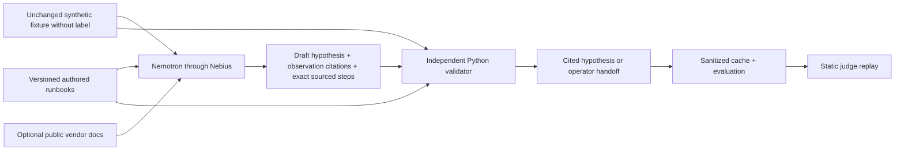

# Nemotron on Nebius — guarded runtime path

**The recorded run behind the judge page (October 21, 2026, evening)** routes between two models: Lightning with reasoning off drafts, Super with reasoning on reads again before physical actions and after vetoes. On 54 incidents the route made 53 correct decisions and 0 unsafe ones for USD 0.040 (Super alone USD 0.091). Results, tuning history and every run of the day: [RUNTIME-EVIDENCE.md](RUNTIME-EVIDENCE.md). Firsthand feedback is reserved for the entrant.

**Recorded commands** (one budget per command; a run is capped at 100 calls):

```sh
sh scripts/signaldesk_live_eval.sh --split hard --no-thinking --reasoning-for nvidia/nemotron-3-super-120b-a12b --max-output-tokens 2048 --max-calls 28 --output runs/hard.json
sh scripts/signaldesk_live_eval.sh --split heldout --no-thinking --reasoning-for nvidia/nemotron-3-super-120b-a12b --max-output-tokens 2048 --output runs/heldout.json
python3 -m signaldesk.replay --report runs/heldout.json --report runs/hard.json --output site --require-live
```

**Afternoon run (superseded for the judge page, kept as evidence).** Results and costs are in [RUNTIME-EVIDENCE.md](RUNTIME-EVIDENCE.md); the raw report is [runtime/live-evaluation-20261021-tape-nothink.json](runtime/live-evaluation-20261021-tape-nothink.json). With `--no-thinking`, Super and Lightning each made 40/40 correct decisions on the 40 held-out tape incidents, for about USD 0.04. An earlier generic-incident version of this entry (October 20) showed why thinking must be off: as specified, Lightning spent its whole output cap on hidden reasoning and validated only 6/40. Firsthand feedback is reserved for the entrant.

**Recommended command:** add `--no-thinking`. It sends `chat_template_kwargs: {"enable_thinking": false}`, and without it Lightning returns empty content with `finish_reason=length`. The default payload below is unchanged so the as-specified run stays reproducible. Each row records the finish reason and the thinking option.

The primary path is now `signaldesk.live`, launched by `scripts/signaldesk_live_eval.sh`. The old FD-based selector in `signaldesk.providers` remains for injected historical tests, but its real network path is retired so it cannot bypass the guard. Use the new launcher for budgeted evaluation, caching and judge export.

## One command for the authorized lead

From the standalone entry root, with `NEBIUS_API_KEY` exported in the environment by your own credential tooling:

```sh
sh scripts/signaldesk_live_eval.sh
```

The application reads **NEBIUS_API_KEY**; never put its value in a command, document, recording, log or chat. This repository contains no key lookup code and never prints environment variables.

Default: all **40 frozen held-out cases**, first Lightning then Super, **80 maximum requests**, **1,500,000 reserved tokens**, **1,600 maximum output tokens per request**, and **USD 1 maximum estimated reservation**. Results are written to `runs/live-evaluation.json`, with sanitized per-request records in `cache/`. Both directories are ignored by Git and excluded from public packaging.

A single-case precheck is available without changing the held-out evaluation:

```sh
sh scripts/signaldesk_live_eval.sh --case cache-demo --models nvidia/Nemotron-3_5-Lightning --max-calls 1 --output runs/precheck.json
```

The lead should confirm rates and account availability immediately before using the broker. One command intentionally performs no retries, automatic fallback, model discovery or account changes. Exit **0** means complete plus synthetic quality gates; **1** means completed but gates failed; **2** means invalid configuration or stopped/partial run. Always read the JSON, including errors and not-run rows. A case can safely abstain without being a correct prediction.

## Actual model involvement



The model drafts a JSON brief: selected runbook, exact hypothesis title, corroborating evidence IDs, an ordered subset of one to three runbook steps with source ID and one-based step number, and optional retrieved public-document citation IDs. The model can prioritize or omit steps. It cannot introduce unsourced prose. Exact copying is deliberate: merely attaching a citation would not establish that arbitrary generated claims follow from the source.

The validator runs **outside the model**, accepts only schema-valid output, checks source text/index/ID equality, rejects duplicate/cross-case/made-up citations and nonnumeric or out-of-range evidence, enforces the source threshold, and forces abstention when multiple families are abnormal. A selected runbook without corroboration produces a handoff. Unknown cases require an empty draft. Rejected schema/prose counts as an **error**, not a correct unknown rejection. Nothing executes remediation.

Only unchanged demo and held-out synthetic fixtures can enter the live adapter. Training text, expected labels, arbitrary files and private incidents cannot. The evaluation layer reads labels only after inference; it preserves all denominators, errors and missed cases. Same-author synthetic results are not external or production validation. The baseline and its frozen files remain unchanged.

## Endpoints, IDs and cost accounting

Base URL: `https://api.tokenfactory.nebius.com/v1/`; request path: `chat/completions`. HTTPS only for real calls, no environmental proxies, no redirects, no streaming, 45-second timeout, 128-KiB response ceiling, strict JSON duplicate/nonfinite rejection. Credentials never enter payloads or cache keys. Provider errors produce fixed messages without response bodies.

Exact IDs and rates were checked against the [public Nebius catalog](https://tokenfactory.nebius.com/api/public/models_info) on **2026-10-18**. Snapshot: [pricing.json](../signaldesk/pricing.json), USD per million input/output tokens:

| Model | Exact ID | Input / output |
|---|---|---:|
| Nano | `nvidia/NVIDIA-Nemotron-3-Nano-30B-A3B` | 0.06 / 0.24 |
| Lightning | `nvidia/Nemotron-3_5-Lightning` | 0.06 / 0.24 |
| Ultra | `nvidia/Nemotron-3-Ultra-550b-a55b` | 1.00 / 3.00 |
| Super | `nvidia/nemotron-3-super-120b-a12b` | 0.30 / 0.90 |
| Super-VL | `nvidia/Nemotron-3.5-Super-VL` | 0.30 / 0.90 |

Before each request, reserve text UTF-8 byte count plus 4,096 framing tokens and maximum output, at **2×** catalog rates. Vision adds 32,768 input tokens. A request that would exceed any cap is refused **before sending**. Failed/unknown requests keep their reservation. Missing/invalid reported usage or an overrun stops the entire run. There is no refund that could permit an extra request. The JSON records reserved upper estimates and observed usage estimates separately; cached replay records zero new calls and cost.

These are conservative estimates, **not an invoice or provider-enforced account cap**. A tokenizer/image protocol could exceed the planning bound, and rates can change. An unexpected already-completed request cannot be undone; the guard stops all subsequent requests. Recheck current prices and provider-side account limits before use. `--cost-multiplier` may only increase the 2× margin, and `--max-usd` cannot exceed 1. Each run is bounded; starting a new run creates a new budget. Do not concurrently launch budgeted runs expecting a shared account-wide limit.

The full local HTTP mock reserved **1,013,370 tokens / USD 0.464653** for 80 requests with default text settings. That number describes this request plan, not a vendor charge. There are no paid calls in worker verification.

## Replay and static export

```sh
# Replay genuine cache without a key or network fallback
sh scripts/signaldesk_live_eval.sh --replay --output runs/replayed.json

# Revalidate cached run evidence and export a static site; mocks are refused
python3 -m signaldesk.replay --report runs/live-evaluation.json --output site --require-live
```

Cache identities include schema, prompt, exact model, synthetic input, runbooks, optional grounding, image and transport origin. Live/mock namespaces differ. Cache loads revalidate IDs, source text and numeric support. Corrupt entries fail closed instead of silently calling the provider. Hashes detect accidental changes; they are not signed provider attestations. Recorded model IDs identify what was requested, not independent server-model attestation.

No raw provider text is persisted. Sanitized briefs retain origin, exact requested model, UTC observation time, elapsed milliseconds, reported usage and input/request fingerprints. A replay-only miss never spends. `--dry-run --replay` replays the separate mock cache and remains labeled mock.

## No-cost acceptance command

```sh
sh scripts/signaldesk_live_eval.sh --dry-run --cache cache/mock --output runs/dry-run.json
```

This starts a temporary **127.0.0.1 port-0** mock HTTP server and passes an internal fake credential. It ignores any real key environment. The server is closed when the command exits. `--dry-run --tavily` is forbidden. The mock uses deterministic telemetry selection and cannot establish NVIDIA runtime, OCR or model performance. The full test suite also injects transports for malformed JSON, fabricated citations, unsafe steps, failures and cost/token boundaries.

## Optional Tavily award path

Opt in with `--tavily` and broker-provided **TAVILY_API_KEY**, plus NEBIUS_API_KEY. Search is off by default and even credential lookup is skipped while disabled. Fixed queries contain only public product topics; incident text, labels and screenshots are never sent to search.

The [Tavily search API](https://docs.tavily.com/documentation/api-reference/endpoint/search) is used with basic search, a three-result limit, explicit vendor domains, no generated answer/raw-page/image retrieval, and automatic parameter selection disabled. Python additionally checks exact HTTPS hosts and documentation path prefixes, rejecting credentials, ports, query strings, fragments, encodings, traversal and lookalike domains. It never follows or fetches result URLs. Up to eight public queries are cached per runbook family.

Retrieved `WEB-*` citations link to public vendor docs as **supplemental reading**. They cannot substitute for incident telemetry or authorize new steps. Snippets are untrusted input; the UI displays only fixed titles and locally checked URLs. Search reserves USD .02 per basic request under the same global dollar/call caps; unexpected credit usage stops the run. Use `--max-calls 88` to permit all 80 model plus up to eight search requests. One genuine grounded run was made on October 20: 8 credits and 12 allowlisted URLs, but **0 citations** in 40 Super drafts. Award eligibility has not been verified, and entering for it is not recommended.

## Super-VL screenshot stretch

```sh
# Worker-safe local transport check
python3 -m signaldesk.vision --dry-run
# Maintainer only, with NEBIUS_API_KEY exported
python3 -m signaldesk.vision
```

The model receives the hash-pinned [synthetic dashboard screenshot](../fixtures/dashboard-clean.png), runbooks and allowed observation IDs. Numeric telemetry values are omitted from its text input so a real model must read them from the screenshot. Deterministic validation uses the corresponding trusted synthetic fixture. One call, 65,000-token run cap, 32,768-token image planning allowance, shared dollar ceiling. Only that bundled image is accepted; there is no arbitrary screenshot upload. The dry-run exercises image transport and validation with a mock that does **not** read pixels. Real Super-VL/OCR performance remains pending.
